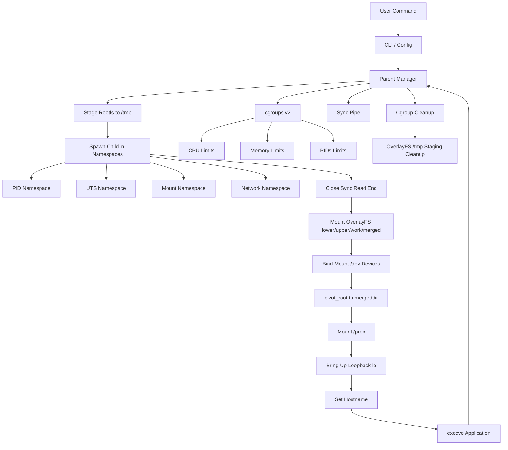

# MiniC — Lightweight Linux Container Runtime from Scratch

MiniC is a lightweight educational Linux container runtime built from scratch in Go that demonstrates process isolation, resource control, filesystem isolation, and network isolation using Linux namespaces (PID, UTS, Mount, Network), cgroups v2, OverlayFS copy-on-write root filesystems, and `pivot_root`.

## Overview
A Linux container is simply an isolated process (or set of processes) running on a host Linux machine, constrained by specific kernel features. MiniC is a from-scratch implementation designed for educational purposes to unveil exactly what goes on under the hood of container tools like Docker and `runc`. This project demonstrates the lowest-level Linux primitives—namespaces, cgroups, and filesystem isolation—without the production-grade complexity of standard industry tools. Note: MiniC is strictly an educational tool and is not production-ready.

## Core Architecture



### Lifecycle:
1. **User Command**: The user invokes `minic run` with resource configurations and an application path.
2. **CLI / Config**: The CLI parses flags and builds the configuration for the runtime.
3. **Parent Manager**: Prepares an isolated staging directory under `/tmp/minic-run-*` with mode `0700`, copying the source rootfs to a Linux-native ext4 mount (`lowerdir`), and provisioning `upperdir`, `workdir`, and `mergeddir`.
4. **Create Child & Namespaces**: The child process is created via `/proc/self/exe child`, directly inheriting new PID, UTS, Mount, and Network namespaces (`CLONE_NEWPID | CLONE_NEWUTS | CLONE_NEWNS | CLONE_NEWNET`).
5. **cgroups v2**: The Parent extracts the child's host PID, initializes a new cgroup, enforces resource limits, and attaches the child.
6. **Synchronization**: The Parent writes a byte to a pipe to signal the child (which was paused waiting for cgroup setup) to resume execution.
7. **OverlayFS Mount & Devices**: The child closes the sync pipe, unshares mount propagation (`MS_PRIVATE`), mounts OverlayFS uniting `lowerdir`, `upperdir`, and `workdir` into `mergeddir`, and bind-mounts essential host character devices (`/dev/null`, `/dev/zero`, `/dev/random`, `/dev/urandom`) into `<mergeddir>/dev`.
8. **pivot_root()**: The child changes its root filesystem from the host to `mergeddir` and detaches the old host root.
9. **/proc**: The `/proc` directory is mounted inside the new rootfs to provide process details to the containerized environment.
10. **Loopback Network Setup**: The child configures its isolated loopback interface (`lo`) to UP and RUNNING state using socket ioctl calls (`SIOCGIFFLAGS`/`SIOCSIFFLAGS`). Host network interfaces are completely hidden.
11. **Hostname & exec()**: The child sets its hostname and replaces itself with the requested application (e.g. `/bin/sh`).
12. **Parent Waits & Cleanup**: The Parent intercepts signals, waits for the container process to exit, preserves the exact exit code, purges the cgroups directory, and cleans up the disposable `/tmp` OverlayFS scratch files.

## Core Linux Concepts Demonstrated

### Namespaces
- **PID**: Process ID isolation. The container process becomes PID 1 and cannot see processes running on the host machine.
- **UTS**: Hostname isolation. The container can define its own hostname (`--hostname`) independently of the host.
- **Mount**: Filesystem and mount isolation. The container can mount/unmount paths without affecting the host machine.
- **Network**: Network stack isolation (`CLONE_NEWNET`). The container possesses its own private network stack and interface table. Host interfaces (`eth0`, `wlan0`) are completely hidden. MiniC brings up the loopback interface (`lo`) with `127.0.0.1` using socket ioctl syscalls, allowing isolated local IPC while intentionally remaining disconnected from external networks.

### cgroups v2
Control Groups (cgroups) govern the resource utilization of a process. MiniC implements:
- `memory.max`: Memory limits for the container. Accepts suffixes `K`, `M`, `G`, raw bytes, or `max` for unlimited. Values must be strictly positive integers.
- `cpu.max`: CPU throttling and utilization caps. Expressed as percentage (e.g., `50` for 50% of 1 core, `150` for 1.5 cores).
- `pids.max`: Limits on the number of processes that can be spawned inside the container. Must be a positive integer.

### Signal Handling & Exit Status
- **Signal Forwarding**: The parent intercepts `SIGINT` (Ctrl+C) and `SIGTERM`, forwards them to the container process, and waits for termination with a 5-second grace period before escalating to `SIGKILL`.
- **Exit Status**: Conventional exit codes are preserved. Processes terminated by a signal `N` return the standard shell status `128 + N` (e.g., 137 for SIGKILL/OOM, 130 for SIGINT, 143 for SIGTERM).
- **Cgroup Cleanup**: Upon process exit, any lingering processes in `cgroup.procs` are terminated and the owned cgroup directory is safely removed with bounded retries.

### Filesystem Isolation & OverlayFS
- **Disposable Copy-on-Write (OverlayFS)**: Containers run inside a union filesystem. The base rootfs serves as the immutable `lowerdir`. All container mutations, newly created files, and deletions are recorded strictly inside `upperdir` and tracked by `workdir`. When the container exits, the temporary staging directory is deleted, leaving the original rootfs completely untouched.
- **WSL 2 Compatibility (Rootfs Staging)**: WSL 2 mounts Windows drives at `/mnt/c` via 9P/drvfs, which lacks full Linux POSIX extended attributes and OverlayFS mount support. MiniC automatically copies the source rootfs into an ephemeral Linux-native directory (`/tmp/minic-run-*`) formatted with mode `0700` before mounting.
- **Minimal Device Provisioning**: Minimal essential character devices (`/dev/null`, `/dev/zero`, `/dev/random`, `/dev/urandom`) are explicitly bind-mounted from the host into the container's isolated `/dev` directory. This provides standard I/O redirection and random data streams without exposing raw host disks or partition block devices.
- **pivot_root**: A Linux syscall that shifts the process's root mount to `mergeddir` and detaches the old host root via `umount2(..., MNT_DETACH)`.
- **/proc**: The virtual filesystem exposing kernel process metrics. Remounted within the container's PID namespace so commands like `ps` function correctly.
- **exec()**: The `execve` syscall replaces the child initialization process entirely with the final containerized application.

## Comparison with runc

| Feature                      | MiniC                         | runc                         |
| ---------------------------- | ----------------------------- | ---------------------------- |
| Linux namespaces             | Yes (PID, UTS, Mount, Net)    | Yes (All namespaces)         |
| cgroups v2                   | Yes (CPU, Memory, PIDs)       | Yes (Full controller set)    |
| Rootfs isolation             | Yes                           | Yes                          |
| OverlayFS copy-on-write      | Yes (Disposable staging)      | Yes (Layered drivers)        |
| Device nodes                 | Minimal (/dev/null, zero, etc)| Configurable / Full /dev     |
| Loopback interface           | Yes (Automatic lo UP)         | Configurable / Pre-start hook|
| pivot_root                   | Yes                           | Yes                          |
| /proc                        | Yes                           | Yes                          |
| CLI                          | Simplified                    | Full OCI runtime interface   |
| OCI specification            | No                            | Yes                          |
| Docker image handling        | No                            | No, handled by higher layers |
| Full lifecycle management    | Limited                       | Extensive                    |
| Production security features | Limited                       | Extensive                    |
| Goal                         | Educational                   | Production container runtime |

## Project Structure
```text
minic/
├── cmd/
│   └── minic/
│       └── main.go         # Application entry point
├── internal/
│   ├── cli/              # Command-line parsing and config routing
│   ├── container/        # Parent process management and lifecycle execution
│   ├── network/          # Network namespace loopback interface setup
│   ├── process/          # Child process initialization and execution
│   ├── cgroup/           # cgroups v2 resource limits configuration
│   └── filesystem/       # Rootfs staging, OverlayFS mount, devices & pivot_root
├── test/
│   ├── integration_cow_test.sh # Privileged OverlayFS copy-on-write integration test
│   └── integration_net_test.sh # Privileged Network isolation integration test
├── docs/                 # Architectural plans and presentation support
├── go.mod                # Go module definitions
├── AGENTS.md             # Developer guidelines
└── README.md             # This document
```

## Testing

### Unprivileged Unit Tests
Unit tests run completely unprivileged without requiring `sudo` or modifying the host cgroup or network hierarchy:

```bash
# Run all unit tests
go test -v ./...

# Run static analysis
go vet ./...
```

### Privileged Integration Tests
To test the complete OverlayFS copy-on-write lifecycle, device node functionality, rootfs protection, and network namespace isolation on a Linux or WSL 2 host with root privileges:

```bash
# Execute automated copy-on-write integration test script
sudo ./test/integration_cow_test.sh

# Execute automated network namespace isolation test script
sudo ./test/integration_net_test.sh
```

## Demo

**NOTE:** Execution and verification require a proper Linux environment or WSL 2.

### Basic execution
```bash
sudo ./minic run ./rootfs /bin/echo hello
```
### Interactive shell
```bash
sudo ./minic run ./rootfs /bin/sh
```
### Hostname isolation
```bash
sudo ./minic run --hostname minic-demo ./rootfs /bin/sh
```
### Resource limits
```bash
sudo ./minic run \
  --memory 256M \
  --cpu 50 \
  --pids 20 \
  ./rootfs /bin/sh
```
### Debug mode
```bash
sudo ./minic run \
  --debug \
  --memory 256M \
  --cpu 50 \
  --pids 20 \
  --hostname minic-demo \
  ./rootfs /bin/sh
```

## Demo Verification Checklist

| Test                   | What it demonstrates                     |
| ---------------------- | ---------------------------------------- |
| `echo hello`           | Basic execution                          |
| `echo $$`              | PID namespace                            |
| `hostname`             | UTS namespace                            |
| `ls /`                 | Rootfs isolation                         |
| `ls /proc`             | proc filesystem                          |
| `touch /newfile`       | OverlayFS copy-on-write (ephemeral write)|
| `cat /dev/null`        | Provisioned minimal device nodes         |
| `ifconfig`             | Network namespace (lo only, host hidden) |
| `ping -c 1 127.0.0.1`  | Loopback network connectivity            |
| resource-limit run     | cgroups v2 resource limits               |
| `exit 42` + shell `$?` | exit-code propagation                    |
| `--debug`              | runtime lifecycle and staging logs       |

## Limitations
- **Linux-only**: Relies heavily on Linux POSIX and kernel APIs (Namespaces, cgroups v2, OverlayFS). It cannot be compiled or tested natively on Windows or macOS.
- **Loopback-Only Networking**: Containers run inside an isolated network namespace with loopback enabled (`127.0.0.1`), but have no external internet access, virtual Ethernet (`veth`) pair bridges, port forwarding, or DNS routing.
- **Not OCI-Compliant**: Does not parse a `config.json` standard OCI bundle.
- **Missing Docker Features**: Does not download remote images or handle complex multi-layer image hierarchies.
- **Security Hardening**: Missing AppArmor, SELinux, User Namespaces, Linux Capabilities, and Seccomp profiles.
- **Rootless Mode**: Not supported.

## Future Work
- Virtual ethernet (`veth`) pair bridging and host NAT routing
- Port forwarding and container IP assignment
- Linux capabilities restriction (`CAP_DROP`) and seccomp filtering
- User namespace support for rootless containers
- OCI `config.json` bundle parsing
- Richer lifecycle commands (`start`, `stop`, `exec`, `ps`)
