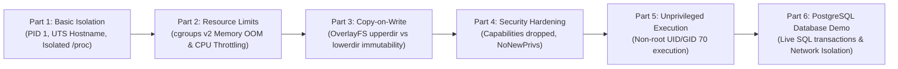

# MiniC — Final Presentation & Viva Examination Guide

This guide is the master technical reference for presenting MiniC at the college project exhibition, viva examination, and final evaluation. It covers the project motivation, live demonstration workflows, architectural blueprints, low-level Linux implementation details, realistic project limitations, and 24 detailed viva examination questions with answers.

---

## Table of Contents

1. [5-Minute Project Pitch & Motivation](#1-5-minute-project-pitch--motivation)
2. [Complete Live Demonstration Sequence](#2-complete-live-demonstration-sequence)
3. [Exact Demonstration Commands & Expected Outputs](#3-exact-demonstration-commands--expected-outputs)
4. [Deep-Dive Explanation of Demonstration Commands](#4-deep-dive-explanation-of-demonstration-commands)
5. [PostgreSQL Real-World Application Demonstration Walkthrough](#5-postgresql-real-world-application-demonstration-walkthrough)
6. [System Architecture & Process Synchronization](#6-system-architecture--process-synchronization)
7. [Key Implementation Details & Linux Kernel Primitives](#7-key-implementation-details--linux-kernel-primitives)
8. [Realistic Project Limitations & Scope Boundaries](#8-realistic-project-limitations--scope-boundaries)
9. [24 Operating Systems Viva Examination Questions & Detailed Answers](#9-24-operating-systems-viva-examination-questions--detailed-answers)
10. [Conclusion & Project Summary](#10-conclusion--project-summary)

---

## 1. 5-Minute Project Pitch & Motivation

### The "Why" Behind MiniC
Modern cloud infrastructure runs almost entirely on containers managed by Docker, Podman, and Kubernetes. However, students and software engineers frequently treat containers as black boxes or mistake them for lightweight virtual machines.

**A container is not a virtual machine.** A container has no guest operating system kernel, no hypervisor, and no virtual hardware emulation. A container is simply a standard Linux user-space process whose visibility into the system is restricted by **Namespaces**, whose resource consumption is metered by **Control Groups (cgroups)**, whose root filesystem is isolated via **`pivot_root`** and **OverlayFS**, and whose privileges are bounded by **Linux Capabilities**.

### What MiniC Demonstrates
MiniC is an educational Linux container runtime written from scratch in Go for an undergraduate Operating Systems project. It implements every core layer of process containerization directly using Linux kernel system calls:

1. **Linux Namespaces:** PID, UTS, Mount, and Network namespaces via `CLONE_NEW*` clone flags.
2. **cgroups v2:** Hard memory caps (`memory.max`), CPU quotas (`cpu.max`), and process limits (`pids.max`).
3. **OverlayFS Copy-on-Write:** Ephemeral container storage where host base images remain immutable.
4. **Filesystem Pivot:** Relocating container root with `pivot_root`, detaching host root with `MNT_DETACH`, and mounting a private `/proc`.
5. **Privilege Hardening:** Stripping capability sets (bounding, ambient, effective, permitted, inheritable) and enforcing `PR_SET_NO_NEW_PRIVS`.
6. **Safe Non-Root Execution:** Optional `--uid` and `--gid` flags with correct OS thread-level credential transitions.
7. **Real-World Service Isolation:** Running an untamed, production-grade service—**PostgreSQL 17.12** on Alpine Linux—demonstrating real relational database transactions inside a completely isolated network and filesystem sandbox.

---

## 2. Complete Live Demonstration Sequence

For a 10–12 minute evaluation or live college presentation, follow this 6-part demonstration sequence:



1. **Part 1 — Process & Hostname Isolation (BusyBox):** Show PID 1 inside the container, custom container hostname, and that host processes are completely invisible.
2. **Part 2 — Resource Enforcement (cgroups v2):** Demonstrate hard memory capping triggering kernel OOM killer, and CPU quota throttling.
3. **Part 3 — Copy-on-Write Filesystem (OverlayFS):** Create and modify files in the container, exit, and verify the host rootfs is byte-for-byte unchanged.
4. **Part 4 — Privilege Stripping & NoNewPrivs:** Inspect `/proc/self/status` showing all capability masks zeroed, and demonstrate blocked privileged syscalls (`sethostname`).
5. **Part 5 — Non-Root Execution:** Launch an unprivileged process with `--uid 1000 --gid 1000`, verifying `id` output and ownership.
6. **Part 6 — Live PostgreSQL Service & Network Isolation:** Launch PostgreSQL 17.12 inside MiniC under UID/GID 70, execute SQL queries over local loopback (`127.0.0.1:15432`), prove the host cannot connect, and demonstrate clean resource cleanup upon container termination.

---

## 3. Exact Demonstration Commands & Expected Outputs

Execute these commands inside your WSL 2 Ubuntu terminal from the project root (`cd minic`).

### Step 0: Clean Build & Test Verification
```bash
make build
make test
```
*Expected Output:*
```text
go build -o bin/minic ./cmd/minic
PASS
ok      minic/internal/cgroup   0.02s
ok      minic/internal/cli      0.01s
ok      minic/internal/container        0.03s
ok      minic/internal/filesystem       0.04s
ok      minic/internal/network  0.02s
ok      minic/internal/process  0.02s
ok      minic/internal/security 0.02s
```

---

### Step 1: Basic Process & Hostname Isolation
```bash
sudo ./bin/minic run --hostname minic-demo ./rootfs /bin/sh -c "uname -n; ps -ef; echo My PID is \$\$"
```
*Expected Output:*
```text
minic-demo
PID   USER     TIME  COMMAND
    1 root      0:00 /bin/sh -c uname -n; ps -ef; echo My PID is $$
My PID is 1
```

---

### Step 2: cgroups v2 Memory Limit (OOM Killer Demonstration)
Launch a container with a strict 32MB physical memory limit and attempt an allocation that exceeds the quota:
```bash
sudo ./bin/minic run --memory 32M ./rootfs /bin/sh -c "dd if=/dev/zero of=/dev/null bs=64M count=1"
```
*Alternative memory stress test (allocating more than 32MB in RAM):*
```bash
sudo ./bin/minic run --memory 16M ./rootfs /bin/sh -c "x=\$(dd if=/dev/urandom bs=1M count=20 2>/dev/null | tr -dc 'a-zA-Z0-9'); echo done"
```
*Expected Output:*
```text
Killed
exit status 137
```
*(Exit code 137 = 128 + 9 [SIGKILL], proving the Linux kernel cgroups v2 OOM killer terminated the out-of-quota container process).*

---

### Step 3: OverlayFS Copy-on-Write Immutability
Verify that mutations inside the container do not persist to the base filesystem:
```bash
# 1. Create a file inside the container
sudo ./bin/minic run ./rootfs /bin/sh -c "echo 'Ephemeral data' > /test_file.txt && cat /test_file.txt"

# 2. Verify that the file DOES NOT exist in the host base rootfs
ls -la ./rootfs/test_file.txt
```
*Expected Output:*
```text
Ephemeral data
ls: cannot access './rootfs/test_file.txt': No such file or directory
```

---

### Step 4: Privilege Hardening & `no_new_privs`
Show that capabilities are zeroed and privileged system calls fail:
```bash
sudo ./bin/minic run ./rootfs /bin/sh -c "grep -E 'Cap(Inh|Prm|Eff|Bnd|Amb)|NoNewPrivs' /proc/self/status"
```
*Expected Output:*
```text
NoNewPrivs:     1
CapInh: 0000000000000000
CapPrm: 0000000000000000
CapEff: 0000000000000000
CapBnd: 0000000000000000
CapAmb: 0000000000000000
```
Now attempt a privileged system call (`hostname` change):
```bash
sudo ./bin/minic run ./rootfs /bin/hostname hacked
```
*Expected Output:*
```text
hostname: sethostname: Operation not permitted
exit status 1
```

---

### Step 5: Safe Non-Root Execution
Launch an unprivileged user process:
```bash
sudo ./bin/minic run --uid 1000 --gid 1000 ./rootfs /bin/sh -c "id; touch /root_test 2>&1 || echo 'Permission denied as expected'"
```
*Expected Output:*
```text
uid=1000 gid=1000
touch: /root_test: Permission denied
Permission denied as expected
```

---

### Step 6: Real-World PostgreSQL Database Service Demonstration

#### Automated Single-Target Run:
```bash
make demo-postgres
```
*Or manual command:*
```bash
sudo ./bin/minic run \
  --rootfs "$HOME/.cache/minic/rootfs-postgres" \
  --uid 70 --gid 70 \
  --memory 256M --cpu 100 --pids 64 \
  --hostname minic-postgres \
  /usr/local/bin/minic-postgres-demo --hold-seconds 120
```

#### Two-Terminal Live Demonstration (Proving Network Isolation):
**Terminal 1 (Host/WSL): Launch the PostgreSQL container:**
```bash
make demo-postgres
```
*Terminal 1 Output:*
```text
======================================================================
 MiniC Containerized PostgreSQL 17 Service Demo
======================================================================
[*] Initializing PostgreSQL cluster at /tmp/minic-pgdata (ephemeral container storage - OverlayFS writable layer)...
[*] Starting isolated PostgreSQL 17 server on port 15432...
[*] Container Environment:
    - User:            postgres (UID 70, GID 70)
    - IP Address:      127.0.0.1
    - Listen Port:     15432
    - Storage Mode:    ephemeral container storage (OverlayFS writable layer)
[*] Executing database workload (CREATE, INSERT, SELECT)...
    -> Table created:  items (id, name, created_at)
    -> Records inserted: 3 rows
    -> Verifying data retrieval:
       1 | MiniC Runtime Demo  | 2026-11-17 15:30:00
       2 | Kernel Namespaces   | 2026-11-17 15:30:00
       3 | cgroups v2 Limits   | 2026-11-17 15:30:00
[+] Database workload executed successfully!
[*] Holding PostgreSQL server active for 120s for host inspection...
[*] Press Ctrl+C at any time in MiniC to trigger graceful shutdown.
```

**Terminal 2 (Host/WSL): Probe the host network to prove isolation:**
```bash
# 1. Attempt to connect from host to container PostgreSQL port 15432:
nc -zv 127.0.0.1 15432 || echo "Connection refused: Host cannot reach container port!"

# 2. Check host listening sockets:
ss -tlpn | grep 15432 || echo "Port 15432 is NOT open on the host!"
```
*Terminal 2 Output:*
```text
nc: connect to 127.0.0.1 port 15432 (tcp) failed: Connection refused
Connection refused: Host cannot reach container port!
Port 15432 is NOT open on the host!
```

---

## 4. Deep-Dive Explanation of Demonstration Commands

### Step 1: Basic Process & Hostname Isolation
When `./bin/minic run` executes:
1. MiniC passes `CLONE_NEWPID | CLONE_NEWUTS | CLONE_NEWNS | CLONE_NEWNET` to the Linux `clone()` syscall via `SysProcAttr`.
2. The child process receives its own PID namespace where it becomes PID 1.
3. In Linux, PID 1 has special semantics: it does not inherit default signal handlers (it ignores unhandled signals), and it is the ancestor of all subsequent processes in that namespace.
4. Mounting a local `/proc` within the Mount namespace ensures that `/bin/ps` reads the container's private PID table, completely shielding host processes.
5. The child calls `unix.Sethostname([]byte("minic-demo"))`. Because of `CLONE_NEWUTS`, this hostname update modifies only the container's UTS namespace structure in the kernel; the host hostname is untouched.

### Step 2: cgroups v2 Memory Limit (OOM Killer)
1. MiniC creates a dedicated cgroup directory at `/sys/fs/cgroup/minic-<host-pid>`.
2. It writes `33554432` (32MB) into `memory.max`.
3. The parent attaches the child host PID into `/sys/fs/cgroup/minic-<host-pid>/cgroup.procs`.
4. When the container allocates beyond 32MB, the Linux kernel's cgroup memory controller detects that the container's memory usage has reached `memory.max`.
5. Because no swap or memory reclamation can fulfill the request, the kernel invokes the **Out-Of-Memory (OOM) killer**, sending `SIGKILL` directly to the container process.
6. MiniC's parent process detects that the child died of signal 9 and returns an exit code of `128 + 9 = 137`.

### Step 3: OverlayFS Copy-on-Write
1. MiniC establishes four paths in a temporary directory (`/tmp/minic-run-*`): `lowerdir`, `upperdir`, `workdir`, and `merged`.
2. The base rootfs is mounted as the read-only `lowerdir`.
3. When `/bin/sh` creates `/test_file.txt`, the Linux VFS (Virtual Filesystem Switch) redirects the write to `upperdir/test_file.txt`.
4. The base image directory remains in read-only mode.
5. When the container terminates, MiniC unmounts `merged` and completely removes the staging directory `/tmp/minic-run-*`. All changes disappear.

### Step 4: Capability Dropping & `no_new_privs`
1. Before executing the user payload, MiniC invokes `runtime.LockOSThread()` to pin the execution to a specific Linux kernel thread.
2. It loops through all 41 capabilities defined in `/proc/sys/kernel/cap_last_cap` and calls `unix.Prctl(PR_CAPBSET_DROP, cap, 0, 0, 0)` to clear the bounding set.
3. It resets the ambient capability set via `PR_CAP_AMBIENT_CLEAR_ALL`.
4. It sets the `PR_SET_NO_NEW_PRIVS` flag via `unix.Prctl(PR_SET_NO_NEW_PRIVS, 1, 0, 0, 0)`.
5. Finally, it calls `unix.Capset` with empty bitmasks for Effective, Permitted, and Inheritable sets.
6. Even though the process still possesses `UID 0`, the kernel refuses `sethostname()` with `EPERM` because the capability `CAP_SYS_ADMIN` is missing.

### Step 5: Safe Non-Root Execution
1. The user specifies `--uid 1000 --gid 1000`.
2. After completing all root-only setup operations (`pivot_root`, `/proc` mount, loopback configuration), the container process transitions its security identity.
3. MiniC first calls `unix.Setresgid(1000, 1000, 1000)` and `unix.Setgroups([]int{1000})`.
4. Next, it calls `unix.Setresuid(1000, 1000, 1000)`.
5. The ordering is critical: once `setresuid` drops root UID, the process loses the privilege to change its GID.
6. Capabilities and `no_new_privs` are configured, and `unix.Exec` replaces the process image.

---

## 5. PostgreSQL Real-World Application Demonstration Walkthrough

### Why PostgreSQL is the Ultimate Runtime Demonstration
Unlike simple BusyBox utilities (`echo`, `ls`, `cat`), running an enterprise relational database engine inside an educational container runtime verifies every single runtime subsystem simultaneously:
- **Non-Root Execution:** PostgreSQL strictly forbids running as `root` (UID 0) for security reasons. MiniC must properly execute as `postgres` (UID 70, GID 70).
- **Filesystem Permissions & Ownership:** PostgreSQL initializes its catalog and WAL (Write-Ahead Logging) via `initdb`, which checks strict file permissions (`0700`) and fails if ownership is not preserved during staging.
- **Process Trees & IPC:** PostgreSQL spawns multiple background processes (`checkpointer`, `background writer`, `walwriter`, `autovacuum launcher`, `logical replication launcher`). MiniC's cgroups and PID namespace must cleanly support multi-process trees.
- **IPC & Loopback Networking:** The database listens on `127.0.0.1:15432` and handles SQL clients over loopback sockets.
- **Resource Discipline:** PostgreSQL requires adequate memory buffers and process slots, regulated by cgroups v2 (`--memory 256M --pids 64`).

### Storage Mode Clarification
The PostgreSQL demonstration script stores its cluster files in `/tmp/minic-pgdata`.
- **Verified Storage Layer:** Inspection of `/proc/self/mountinfo` inside the container reveals that the only mounted filesystems are the root OverlayFS (`overlay` on `/tmp/minic-run-*/upper`), virtual `/proc`, and bind-mounted character devices.
- **Accurate Architectural Classification:** `/tmp/minic-pgdata` is stored on **ephemeral container storage (the OverlayFS writable layer `upperdir`)**, not a separate RAM-backed `tmpfs`.
- When MiniC exits, the entire staging directory is unlinked, automatically purging the database cluster and guaranteeing host cleanliness.

---

## 6. System Architecture & Process Synchronization

### Re-exec Pattern & Architecture Diagram

```mermaid
flowchart TD
    subgraph Host["Host Environment (WSL 2 Linux Kernel)"]
        A["minic run <args> <rootfs> <cmd>"] --> B["internal/cli: Parse & Validate Flags"]
        B --> C["internal/container: Stage Rootfs to /tmp/minic-run-*"]
        C --> D["Create Anonymous Sync Socket/Pipe"]
        D --> E["Spawn Re-Exec Child:\n/proc/self/exe child <args>"]
        
        E -. "CLONE_NEWPID | CLONE_NEWUTS\nCLONE_NEWNS | CLONE_NEWNET" .-> F["Child Process\n(Host PID: X, Namespace PID: 1)"]
        
        E --> G["Parent Extracts Child Host PID X"]
        G --> H["internal/cgroup: Create /sys/fs/cgroup/minic-X"]
        H --> I["Apply Limits: memory.max, cpu.max, pids.max"]
        I --> J["Write Host PID X to cgroup.procs"]
        J --> K["Parent Sends 1-Byte Unlock Token over Pipe"]
        
        K -. "Signal Unlock" .-> L["Child Unblocks from Pipe Read"]
        
        subgraph ChildNS["Container Namespaces (Child Process X)"]
            L --> M["internal/process: Initialize Mount Namespace"]
            M --> N["Mount Private Propagation (MS_PRIVATE)"]
            N --> O["Mount OverlayFS (lower/upper/work -> merged)"]
            O --> P["Bind Mount Devices: /dev/null, zero, random, urandom"]
            P --> Q["pivot_root into merged & Detach Old Root (MNT_DETACH)"]
            Q --> R["Mount Isolated /proc"]
            R --> S["internal/network: Activate Loopback (SIOCSIFFLAGS IFF_UP)"]
            S --> T["Set Hostname (unix.Sethostname)"]
            T --> U["internal/process: Transition UID/GID (Setresgid, Setresuid)"]
            U --> V["internal/security: runtime.LockOSThread()"]
            V --> W["Drop Bounding Set Caps (PR_CAPBSET_DROP)"]
            W --> X["Clear Ambient Caps (PR_CAP_AMBIENT_CLEAR_ALL)"]
            X --> Y["Enable no_new_privs (PR_SET_NO_NEW_PRIVS)"]
            Y --> Z["Zero Capset (unix.Capset)"]
            Z --> AA["unix.Exec(targetCmd) -> Application Executes"]
        end
        
        AA --> AB["Application Running (BusyBox or PostgreSQL)"]
        AB --> AC["Parent Intercepts SIGINT/SIGTERM & Forwards to Child"]
        AC --> AD["Process Exits: Parent Reads Exit Status"]
        AD --> AE["Parent Deferred Cleanup:\n1. Terminate remaining cgroup procs\n2. Remove cgroup directory\n3. Unmount & remove staging rootfs"]
        AE --> AF["Parent Exits with Child Exit Code"]
    end
```



### Why Socketpair / Pipe Synchronization is Essential
1. **The Race Condition:** When a process is spawned with `CLONE_NEWPID`, it becomes PID 1 inside its own namespace, but receives a regular host PID (e.g., PID 18452) in the root PID namespace.
2. **cgroups v2 requires the host PID:** The Linux kernel cgroups v2 controller file `/sys/fs/cgroup/minic-<pid>/cgroup.procs` requires the process's **host PID**. The child cannot write its own PID because inside the container it only knows it is PID 1.
3. **Preventing Unmetered Execution:** If the child were allowed to execute immediately without synchronization, it could fork thousands of processes or allocate hundreds of megabytes before the parent finished writing to `/sys/fs/cgroup/...`.
4. **The Solution:** The child process opens an anonymous pipe or socket file descriptor and synchronously executes `read(fd, &buf, 1)`. The child blocks completely in the kernel. Only after the parent sets all cgroup limits and writes the child's host PID to `cgroup.procs` does the parent write a single byte to the pipe, unlocking the child.

---

## 7. Key Implementation Details & Linux Kernel Primitives

### 1. `pivot_root` vs `chroot`
| Feature | `chroot` | `pivot_root` (MiniC) |
| :--- | :--- | :--- |
| **Mechanism** | Modifies process root pointer (`current->fs->root`) | Swaps filesystem mount table entries in the mount namespace |
| **Security** | Easily escaped via `fchdir` on an open file descriptor outside root | Secure; old host root is completely unmounted and detached |
| **Host Root Removal** | Old root remains accessible in kernel mount table | Old root moved to temporary path and unmounted via `umount2(..., MNT_DETACH)` |
| **Prerequisites** | None | Requires a mount point (OverlayFS `merged` bind-mounted to itself) |

### 2. WSL 2 Rootfs Staging (`internal/filesystem/copy.go`)
Under WSL 2, Windows drives are mounted via `drvfs`/`9P` at `/mnt/c`. The 9P filesystem driver does not implement Linux POSIX file attributes, file ownership (UID/GID), character device creation, or extended attributes (`trusted.overlay.*`).
- MiniC checks if the base rootfs resides on an unsupported filesystem.
- It copies the rootfs to native Linux storage at `/tmp/minic-run-*`.
- **Ownership Preservation:** To support non-root execution (e.g., PostgreSQL with UID 70), MiniC streams the rootfs using `tar` preservation (`tar -cpf - . | tar -xpf - -C <target>`) or low-level `lchown`, ensuring that non-root file ownership is preserved byte-for-byte.

### 3. Loopback Networking Activation (`internal/network/net.go`)
When `CLONE_NEWNET` runs, the container gets a private network stack containing only the `lo` interface in the `DOWN` state.
Instead of requiring external tools like `ip` or `ifconfig` (which may not exist in minimal root filesystems), MiniC uses low-level socket ioctls:
```go
// 1. Open raw AF_INET datagram socket
fd, err := unix.Socket(unix.AF_INET, unix.SOCK_DGRAM, 0)

// 2. Query interface flags via SIOCGIFFLAGS for "lo"
// 3. Bitwise-OR flags with IFF_UP | IFF_RUNNING
// 4. Set interface flags via SIOCSIFFLAGS
```
This boots the loopback interface with IP `127.0.0.1` natively from Go code.

### 4. Privilege Dropping Sequence
To ensure maximum security:
1. `runtime.LockOSThread()`: Go multiplexes goroutines over multiple OS threads. Calling `LockOSThread()` ensures that capability changes apply to the active kernel thread without goroutine migration.
2. `PR_CAPBSET_DROP`: Clears the capability bounding set so no capability can ever be re-acquired.
3. `PR_CAP_AMBIENT_CLEAR_ALL`: Clears all ambient capabilities to prevent inheritance across `execve`.
4. `PR_SET_NO_NEW_PRIVS`: Prevents setuid binaries from escalating privileges.
5. `unix.Capset`: Zeroes Effective, Permitted, and Inheritable bitmasks.

---

## 8. Realistic Project Limitations & Scope Boundaries

To answer examiner questions with academic honesty, acknowledge these deliberate project boundaries:

1. **Educational Scope vs Production Container Engines:** MiniC was built to teach and demonstrate operating system primitives. It is not an OCI-compliant daemon like `containerd` or `docker`.
2. **No User Namespaces (`CLONE_NEWUSER`):** MiniC processes run with real host UIDs (e.g., UID 0 or UID 70). It does not map virtual container UIDs to unprivileged host UIDs via `/proc/self/uid_map`.
3. **No External Network Bridging:** MiniC provides loopback networking only (`127.0.0.1`). It intentionally omits `veth` pair creation, host bridge attachment, NAT (Network Address Translation), and port forwarding.
4. **No Seccomp BPF Syscall Filtering:** While Linux capabilities are completely stripped, arbitrary non-privileged system calls are not filtered by a Berkeley Packet Filter (BPF).
5. **No Persistent External Volumes:** Storage is strictly ephemeral via the OverlayFS writable layer. Volume bind mounts (e.g., `-v /host/path:/container/path`) are not implemented.
6. **No Detached / Daemon Mode:** MiniC runs strictly in the foreground, synchronizing process lifecycle and forwarding signals synchronously.

---

## 9. 24 Operating Systems Viva Examination Questions & Detailed Answers

### Concept 1: Virtualization vs Containerization
#### Q1: What is the fundamental difference between a container and a virtual machine?
- **Virtual Machine (VM):** Relies on a hypervisor (such as KVM, VMware, or Hyper-V) to virtualize physical hardware (virtual CPU, RAM, NIC, disk). Each VM boots and runs a full guest operating system kernel.
- **Container:** A group of standard user-space processes running directly on the host Linux kernel. It uses kernel features (**Namespaces** for view isolation and **cgroups** for resource constraints) to sandbox the process without running a separate kernel.

#### Q2: What are the primary performance and resource differences between containers and VMs?
Containers share the host kernel and execute native machine instructions directly on host CPUs without hypervisor translation overhead. They boot in milliseconds (the time required to fork and exec a process) and consume only the memory needed by the containerized application. VMs require gigabytes of RAM to run the guest kernel and background OS services and take tens of seconds to boot.

---

### Concept 2: Linux Namespaces & Isolation
#### Q3: What is the difference between Linux Namespaces and Control Groups (cgroups)?
- **Namespaces isolate what a process can SEE:** They virtualize system resources (PID table, network interfaces, mount points, hostnames, IPC) so a process appears to have its own dedicated operating system instance.
- **Control Groups (cgroups) isolate what a process can USE:** They meter, account for, and constrain resource consumption (CPU cycles, physical RAM, process count, disk I/O).

#### Q4: Which Linux namespaces are implemented in MiniC, and what does each achieve?
MiniC combines four clone flags via `unix.SysProcAttr{Cloneflags: ...}`:
1. `CLONE_NEWPID` (**PID Namespace**): The container process becomes PID 1 in a private process table and cannot see or signal host processes.
2. `CLONE_NEWUTS` (**UTS Namespace**): Isolates the system hostname and NIS domain, allowing independent hostname configuration.
3. `CLONE_NEWNS` (**Mount Namespace**): Isolates the filesystem mount table so container mounts do not pollute the host.
4. `CLONE_NEWNET` (**Network Namespace**): Isolates network stack interfaces, routing tables, and socket tables. Host interfaces (`eth0`) are completely hidden.

#### Q5: Why does `ps -ef` inside the container show only container processes?
`ps` reads the virtual `/proc` filesystem. Because MiniC unmounts the host `/proc` and mounts a fresh instance of `/proc` inside the container's private PID and Mount namespaces, the `/proc` filesystem dynamically generates entries only for processes within that PID namespace.

---

### Concept 3: Process Synchronization & Lifecycle
#### Q6: Why does MiniC require parent-child synchronization via an anonymous pipe/socket?
When `CLONE_NEWPID` is used, the child process does not know its host PID—inside its namespace, it is PID 1. However, Linux cgroups v2 is managed on the host filesystem (`/sys/fs/cgroup/minic-<host-pid>/cgroup.procs`), which requires the child's **host PID**.
- If the child ran immediately, it could execute user commands and consume unmetered resources before the parent configured cgroup limits.
- **Solution:** The child blocks on reading 1 byte from an anonymous pipe. The parent grabs the child's host PID, initializes the cgroup, writes `memory.max`, `cpu.max`, `pids.max`, registers the child's host PID into `cgroup.procs`, and only then writes the 1-byte unlock token to the pipe.

#### Q7: What is the "re-exec" pattern and why does MiniC re-execute `/proc/self/exe child`?
In Go, the runtime initializes multi-threaded runtime support (garbage collection, scheduler threads) before executing `main()`. In Linux, the `fork()` system call inside a multi-threaded process duplicates only the calling thread, which can leave runtime locks and threads in an undefined state. Furthermore, Go does not provide a raw `fork()` API.
MiniC uses the standard container pattern (used by `runc` and Docker): the parent executes `exec.Command("/proc/self/exe", "child", ...)` with `SysProcAttr.Cloneflags`. This re-executes the compiled binary as a fresh process with newly initialized namespaces.

#### Q8: How does MiniC handle signals like Ctrl+C (SIGINT) and termination (SIGTERM)?
The parent process registers a signal notification channel (`signal.Notify`) for `SIGINT` and `SIGTERM`. When a signal is caught, the parent forwards the signal to the container process. If the container process does not terminate within a 5-second grace period, MiniC escalates by sending `SIGKILL` to forcefully terminate the process tree.

#### Q9: How are exit codes preserved when the container terminates?
MiniC captures the child's process state (`processState.Sys().(syscall.WaitStatus)`). If the process exited normally via `exit(n)`, MiniC extracts `ws.ExitStatus()` and exits with that exact integer. If the process was terminated by a signal (e.g., SIGKILL from OOM killer), MiniC follows standard POSIX conventions and returns `128 + int(ws.Signal())` (e.g., $128 + 9 = 137$).

---

### Concept 4: Filesystem Isolation & OverlayFS
#### Q10: How does `pivot_root` differ from `chroot` or changing directory?
- **`chdir`:** Only updates the current working directory pointer (`PWD`). Absolute paths (`/etc/shadow`) still resolve against the host root.
- **`chroot`:** Changes the apparent root for path resolution, but does not move the mount point. A process holding an open file descriptor outside the chroot can break out using `fchdir("..")`.
- **`pivot_root`:** Swaps the actual mount point of the root filesystem in the mount namespace. It moves the host root to a temporary sub-mount (`/.minic_oldroot`), makes the container rootfs the new root, and allows unmounting the host root via `umount2(..., MNT_DETACH)`. Escape is impossible.

#### Q11: How does OverlayFS implement Copy-on-Write (COW)?
OverlayFS combines multiple directories into a single unified mount point:
- **`lowerdir` (Read-Only):** The base container image. Files are read from here but never written.
- **`upperdir` (Read-Write):** Ephemeral directory where all new files, modifications, and deletions are written.
- **`workdir` (Internal):** Scratch directory used for atomic copy-up operations.
- **`merged` (Unified Mount):** The resulting filesystem seen by the container.
When a container modifies a base file, OverlayFS copies the file from `lowerdir` to `upperdir` (copy-up) before writing. Deletions create a character device with major/minor 0/0 (a whiteout) in `upperdir`. The base image is never touched.

#### Q12: Why does WSL 2 require rootfs staging to `/tmp` before mounting OverlayFS?
In WSL 2, files under Windows paths (`/mnt/c/...`) are accessed via the `9P`/`drvfs` filesystem driver. OverlayFS requires the underlying backing filesystem to support Linux extended attributes (`trusted.overlay.*`), character device nodes, and exact POSIX permissions. Because `drvfs` does not fully support these, MiniC detects when a rootfs is on an unsupported filesystem and stages it to native Linux storage (`/tmp/minic-run-*`) formatted with `ext4`/`tmpfs`.

---

### Concept 5: Control Groups (cgroups v2)
#### Q13: What specific cgroups v2 controllers does MiniC configure?
1. **`memory.max`:** Hard upper memory limit in bytes. Suffixes `K`, `M`, `G` are parsed and converted to bytes. If exceeded, the kernel OOM killer terminates the container.
2. **`cpu.max`:** Configures CPU quota over a $100000\,\mu\text{s}$ (100 ms) period. For example, `--cpu 50` writes `50000 100000` (50% of one core).
3. **`pids.max`:** Caps the maximum number of simultaneous tasks (processes and threads) inside the cgroup, completely neutralizing fork-bomb attacks.

#### Q14: Why can't a PID namespace alone prevent a fork-bomb attack?
A PID namespace gives a process a separate PID numbering space, but it does **not** restrict how many processes can be created. Without cgroup limits, a process inside a PID namespace can continuously invoke `fork()`, exhausting the host kernel's PID table (`/proc/sys/kernel/pid_max`) or physical memory and crashing the entire host operating system. `pids.max` strictly limits the number of tasks.

---

### Concept 6: Security Hardening & Capabilities
#### Q15: What is the difference between UID 0 and Linux capabilities?
Historically in UNIX, privilege was binary: UID 0 had full superuser permissions, and non-zero UIDs had none. Modern Linux divides superuser privileges into 41 discrete units called **capabilities** (`CAP_SYS_ADMIN`, `CAP_NET_ADMIN`, `CAP_NET_RAW`, `CAP_SETUID`, etc.).
Even if a container process runs with `UID == 0`, if its capability sets are stripped, it **cannot** perform privileged operations. For example, without `CAP_SYS_ADMIN`, it cannot mount filesystems or change hostnames.

#### Q16: What does `PR_SET_NO_NEW_PRIVS` guarantee, and why is it essential?
Enabling `no_new_privs` via `unix.Prctl(unix.PR_SET_NO_NEW_PRIVS, 1, ...)` guarantees that the calling thread and all its child processes can **never** gain privileges across `execve`.
Specifically, executing binaries with the setuid bit (`chmod 4755`) or file capabilities (`setcap`) will **not** grant elevated credentials. This prevents privilege escalation attacks inside the container.

#### Q17: Why must `runtime.LockOSThread()` be called before dropping capabilities in Go?
The Go runtime scheduler multiplexes many goroutines onto a pool of operating system threads ($M:N$ threading model). In Linux, capabilities and `no_new_privs` are thread-level attributes. If a goroutine drops capabilities on OS thread A and is then rescheduled onto OS thread B by Go's scheduler, the process would still possess capabilities on thread B. `runtime.LockOSThread()` permanently binds the calling goroutine to its current OS thread, ensuring that credential transitions apply deterministically to the thread that calls `unix.Exec`.

---

### Concept 7: Non-Root Execution & PostgreSQL Integration
#### Q18: Why does PostgreSQL refuse to start as UID 0 (root)?
PostgreSQL contains an internal safety check in its source code that immediately aborts startup if executed by `root`. Because PostgreSQL allows executing user-defined server-side functions (in C, PL/pgSQL, Python) and writing server log files, running as root would allow any database administrator to overwrite critical operating system files or gain root access to the host. MiniC provides `--uid 70 --gid 70` to execute PostgreSQL safely as an unprivileged user.

#### Q19: In what order must UID and GID transitions occur, and why?
The transition must set GID **before** setting UID:
1. First: `unix.Setresgid(gid, gid, gid)` and `unix.Setgroups([]int{gid})`.
2. Second: `unix.Setresuid(uid, uid, uid)`.
If a process calls `setresuid` first, it immediately relinquishes root privileges. Once it is no longer root, the Linux kernel denies subsequent calls to `setresgid` with `EPERM`.

#### Q20: How does MiniC preserve non-root file ownership during rootfs staging?
When rootfs files are copied from a base image to the temporary staging directory, standard file copying routines create new files owned by `root:root`. If the rootfs contains PostgreSQL binaries and configuration owned by UID 70, changing ownership to root breaks PostgreSQL. MiniC uses `tar` streaming (`tar -cpf - . | tar -xpf - -C <target>`) with the `-p` (preserve permissions/ownership) flag to ensure all UIDs and GIDs are copied faithfully.

#### Q21: Where is PostgreSQL data stored, and is it a tmpfs?
In MiniC's PostgreSQL demonstration, database files are stored at `/tmp/minic-pgdata`.
Container inspection of `/proc/self/mountinfo` proves that there is no separate `tmpfs` mounted on `/tmp`. The entire root filesystem is backed by the OverlayFS `merged` layer. Therefore, `/tmp/minic-pgdata` resides on **ephemeral container storage (the OverlayFS writable `upperdir` layer)**. When the container exits, MiniC deletes the staging directory, completely cleaning up the database.

#### Q22: Why can't the host connect to PostgreSQL on port 15432 during the demo?
The network namespace (`CLONE_NEWNET`) completely isolates network stacks. PostgreSQL binds to `127.0.0.1:15432` within the container's private loopback interface (`lo`). Because MiniC intentionally does not configure virtual ethernet pairs (`veth`), network bridging, or iptables NAT forwarding, the container's network stack is inaccessible from the host's network interfaces. Host commands like `nc -zv 127.0.0.1 15432` fail with `Connection refused`.

---

### Concept 8: Production Comparison & Limitations
#### Q23: How does MiniC compare to runc and Docker?
- **Docker:** A complete container ecosystem that includes an image builder, image registry client, REST API daemon (`dockerd`), and volume/network managers.
- **runc:** The Open Container Initiative (OCI) reference runtime that implements `config.json` specifications, user namespaces, full cgroups v1/v2, seccomp BPF filters, and AppArmor/SELinux profiles.
- **MiniC:** A lightweight, educational container runtime built to demonstrate core OS mechanisms. It operates directly on rootfs directories, omits daemons and image formats, and focuses on transparent, readable implementations of namespaces, cgroups v2, OverlayFS, and privilege dropping.

#### Q24: What are the main security features that MiniC intentionally omits?
1. **User Namespaces (`CLONE_NEWUSER`):** Root inside the container is still host root (UID 0).
2. **Seccomp Syscall Filtering:** Dangerous system calls like `bpf()` or `keyctl()` are not blocked by BPF filters.
3. **Virtual Filesystem Masking:** Host `/proc/sys` and `/sys` are not mounted read-only.
4. **Mandatory Access Control (MAC):** No AppArmor or SELinux policies are attached.

---

## 10. Conclusion & Project Summary

MiniC successfully proves that containers are not mysterious virtual machines, but rather ordinary Linux processes wrapped in native operating system primitives.

Through five architectural layers:
1. **Isolation** via Linux Namespaces (`CLONE_NEWPID`, `CLONE_NEWUTS`, `CLONE_NEWNS`, `CLONE_NEWNET`),
2. **Resource Governance** via Linux cgroups v2 (`memory.max`, `cpu.max`, `pids.max`),
3. **Storage Virtualization** via OverlayFS Copy-on-Write and `pivot_root`,
4. **Privilege Hardening** via Capability Dropping and `PR_SET_NO_NEW_PRIVS`, and
5. **Real-World Service Support** via safe non-root execution and PostgreSQL 17.12 integration,

MiniC provides a transparent, verifiable, and comprehensive educational implementation of a modern Linux container runtime.
