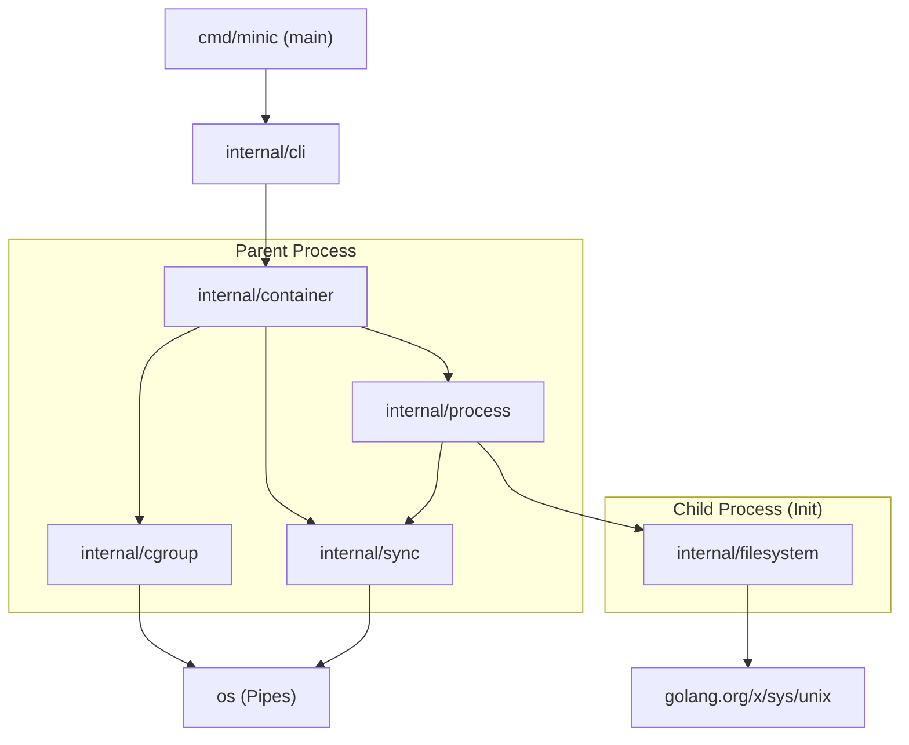

# MiniC Dependency Graph

This document illustrates the internal package dependencies for the MiniC runtime. Unlike `runc`, MiniC relies entirely on the Go standard library (and its extended `golang.org/x/sys/unix` package) and does not use complex third-party CGO or OS-specific external modules (like `opencontainers/cgroups` or `opencontainers/selinux`).

**Important**: MiniC is a standalone project that never imports `runc` as a dependency.

## 1. External Dependencies
- **Standard Library Only**: `os`, `os/exec`, `fmt`, `flag`, `path/filepath`.
- **System Calls**: `golang.org/x/sys/unix` (Recommended for modern Linux syscall constants and types instead of the deprecated `syscall` package where possible).

## 2. Internal Package Graph

## 3. Package Responsibilities

### `cmd/minic`
- The entrypoint. Handles the execution mode (either the parent `run` command or the hidden `child` command).

### `internal/cli`
- Parses CLI flags (`--cpu`, `--memory`, `--pids`, `--hostname`, `--debug`).
- Validates the rootfs path and executable arguments.
- Passes a configuration struct to the `container` manager.

### `internal/container`
- **Parent Logic**: Creates the cgroup, prepares the `os/exec.Cmd` for the child process with namespace `Cloneflags`, sets up the synchronization pipe, starts the child, adds the child's PID to the cgroup, signals the child to continue, and waits for it to exit. Performs cleanup.
- **State Management**: Only tracks basic minimal states (`Created`, `Starting`, `Running`, `Stopped`).

### `internal/process`
- **Child Logic**: Acts as the `init` process inside the container namespaces.
- Waits for the parent's signal via the pipe (ensuring cgroups are applied).
- Hands over to `internal/filesystem` for rootfs setup.
- Sets the hostname.
- Executes the final user command via `unix.Exec()`.

### `internal/cgroup`
- Simplistic cgroups v2 management.
- Creates `/sys/fs/cgroup/minic_<id>`.
- Writes limits to `cpu.max`, `memory.max`, and `pids.max`.
- Writes the child's PID to `cgroup.procs`.
- Removes the cgroup directory upon container destruction.

### `internal/filesystem`
- Handles mount namespaces.
- Makes mount propagation private.
- Bind-mounts the rootfs.
- Mounts `/proc`.
- Performs `unix.PivotRoot()`.
- Unmounts the old root.

### `internal/sync`
- Provides simple blocking IPC using an `os.Pipe` to synchronize the parent (cgroup assignment) and the child (filesystem/execution phase).
