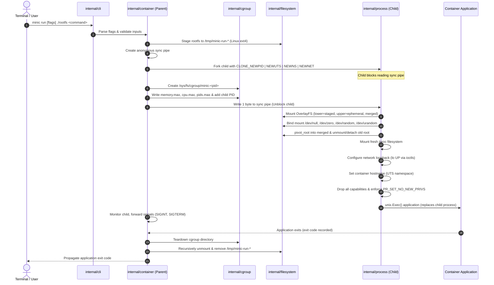

# MiniC — VS Code Workspace: Build, Run, and Complete Demonstration Guide

> **Audience:** Undergraduate Operating Systems students, laboratory evaluators, and viva examiners.  
> **Target Environment:** Windows 10/11 with WSL 2 (Ubuntu), Visual Studio Code, and Go 1.24+.  
> **Workspace Path:** `/mnt/c/Users/Swaraj Shedge/Desktop/College/TY/OS/OS Project/minic`  
> **Git Repository:** [https://github.com/SwarajShedge27/minic-os-container-runtime](https://github.com/SwarajShedge27/minic-os-container-runtime)

---

## Quick-Reference Execution Lifecycle

To avoid confusion during your college evaluation, every action falls into one of five distinct categories:

| Badge | Frequency | Description | Examples |
|---|---|---|---|
| `[ALREADY COMPLETED]` | **Never repeated** | Host machine prerequisites and repository setup. | Installing WSL, Ubuntu, VS Code, Go, Git, Make, cloning repo, downloading dependencies. |
| `[PER SESSION]` | **Once per session** | Actions performed whenever opening your laptop or VS Code. | Opening WSL Ubuntu terminal, navigating to the directory, launching VS Code with `code .`. |
| `[PER CODE CHANGE]` | **When code changes** | Actions performed only after editing Go files or pulling commits. | Running `make build` to compile `bin/minic`. |
| `[PER RUN]` | **Every container run** | Commands executed to launch containers with MiniC. | Running `sudo ./bin/minic run ...`. |
| `[OPTIONAL]` | **As needed** | Comprehensive verification checks and integration tests. | Running `make check`, `make integration`, or individual test scripts. |

> [!IMPORTANT]
> **What You Never Need to Redo Under Normal Conditions:**
> - You do **NOT** need to install WSL or Ubuntu again.
> - You do **NOT** need to reinstall VS Code or its WSL/Go extensions.
> - You do **NOT** need to reinstall Go, Git, or Make.
> - You do **NOT** need to clone the repository again or create a duplicate folder.
> - You do **NOT** need to run `go mod download` or `go mod tidy` every time you open VS Code.
> - You do **NOT** need to rebuild the binary if you have not modified Go source files.
> - Temporary OverlayFS staging directories (`/tmp/minic-run-*`) and cgroup directories (`/sys/fs/cgroup/minic-*`) are created and cleaned up **automatically** by MiniC on every run.

---

## PART 1 — Open the Existing MiniC Project in VS Code `[PER SESSION]`

Follow these steps every time you begin a working or presentation session.

### Step 1: Open Ubuntu WSL Terminal
On Windows, open Ubuntu in one of these ways:
- **Method A (Start Menu):** Press the `Windows Key`, type `Ubuntu`, and press `Enter`.
- **Method B (Windows Terminal):** Open Windows Terminal, click the dropdown arrow (`∨`), and select **Ubuntu**.
- **Method C (Run Dialog):** Press `Win + R`, type `wsl -d Ubuntu`, and press `Enter`.

### Step 2: Navigate to the MiniC Project Directory
In your Ubuntu WSL bash prompt, navigate to your existing project workspace:
```bash
cd '/mnt/c/Users/Swaraj Shedge/Desktop/College/TY/OS/OS Project/minic'
```

> [!NOTE]
> Single quotes are required because the directory path contains spaces (`Swaraj Shedge` and `OS Project`).

Verify your current directory:
```bash
pwd
```
*Expected Output:*
```text
/mnt/c/Users/Swaraj Shedge/Desktop/College/TY/OS/OS Project/minic
```

### Step 3: Launch VS Code Connected to WSL
From the project directory inside Ubuntu WSL, launch Visual Studio Code:
```bash
code .
```
This launches VS Code on Windows while running the VS Code Server inside WSL Ubuntu.

### Step 4: Confirm VS Code Is Connected to WSL Ubuntu
Once VS Code opens, look at the **bottom-left corner** of the window:
- You should see a bright **green badge** displaying:
  ```text
  >< WSL: Ubuntu
  ```
- If the green badge is present, VS Code is directly connected to your Linux kernel environment.
- If the badge is missing (showing only Windows paths or no remote indicator), VS Code opened in Windows mode. Press `F1`, type `WSL: Reopen Folder in WSL`, and press `Enter`.

### Step 5: Open the Integrated Terminal in VS Code
Inside VS Code:
- Press the keyboard shortcut: **``Ctrl + ` ``** (Ctrl + Backtick, the key below Esc).
- Alternatively, go to the top menu: **Terminal** > **New Terminal**.

### Step 6: Confirm the Terminal Is Running Ubuntu Bash
In the integrated terminal, verify that you are running in Linux:
```bash
echo $SHELL
uname -s
```
*Expected Output:*
```text
/bin/bash
Linux
```
If the terminal prompt shows `PS C:\...` (PowerShell), click the dropdown arrow next to the `+` icon in the terminal panel and select **Ubuntu (WSL)** or **bash**.

### Filesystem Architecture Explanation
Your project is located on `/mnt/c/...`, which is a Windows NTFS drive accessed via WSL's DrvFs 9P filesystem bridge.
- **The Limitation:** Windows NTFS filesystems do not support native Linux extended attributes (`xattr`), OverlayFS upper/work directories, or unix character device nodes (`mknod`).
- **How MiniC Solves This:** MiniC is engineered to automatically copy and stage the rootfs into `/tmp/minic-run-*` on WSL's native `ext4` Linux filesystem during execution.
- **Why this matters:** You **do not** need to move your repository or create duplicate workspaces. MiniC runs seamlessly from `/mnt/c` while transparently maintaining full Linux kernel filesystem semantics.

---

## PART 2 — Verify the Existing Environment `[ALREADY COMPLETED]`

Because everything is already installed, **do not** install packages, download dependencies, or alter system configurations. Run these verification commands to confirm system readiness.

```bash
# 1. Verify Go version (requires Go 1.24+, project module uses 1.26)
go version

# 2. Verify Git is available
git --version

# 3. Verify Make is available
make --version

# 4. Verify Git branch is on 'main'
git branch --show-current

# 5. Verify Git working tree is clean
git status

# 6. Verify bundled BusyBox rootfs exists
ls -ld rootfs

# 7. Verify BusyBox binary has executable permissions
ls -l rootfs/bin/busybox

# 8. Verify developer automation Makefile exists
ls -l Makefile

# 9. Verify all 4 privileged integration test scripts exist and are executable
ls -l test/integration_*.sh
```

### Expected Output Summary
```text
go version go1.26.8 linux/amd64
git version 2.43.0
GNU Make 4.3
main
On branch main, nothing to commit, working tree clean
drwxrwxrwx ... rootfs
-rwxrwxrwx ... rootfs/bin/busybox
-rwxrwxrwx ... Makefile
-rwxrwxrwx ... test/integration_cgroup_test.sh
-rwxrwxrwx ... test/integration_cow_test.sh
-rwxrwxrwx ... test/integration_net_test.sh
-rwxrwxrwx ... test/integration_sec_test.sh
```

### What to Do ONLY If a Check Fails
- If `rootfs/bin/busybox` is not executable: Run `chmod +x rootfs/bin/busybox`.
- If on a different Git branch: Run `git checkout main`.
- If `make` is not found: Run `sudo apt update && sudo apt install -y make`.
- If `go: command not found`: Ensure `/usr/local/go/bin` is in your `PATH` (see Troubleshooting).

---

## PART 3 — Understand the Project Structure

MiniC is organized into modular packages, each handling a distinct operating system responsibility:

```text
minic/
├── cmd/
│   └── minic/
│       └── main.go              # Application entry point; dispatches CLI commands and child re-exec
├── internal/
│   ├── cli/                   # Flag definitions (--memory, --cpu, --pids, etc.), parsing & exit codes
│   ├── container/             # Parent supervisor: pipe sync, fork/exec with clone flags, cgroups & signals
│   ├── process/               # Child bootstrap: waits on pipe, mounts /proc, pivot_root, loopback, security
│   ├── filesystem/            # Rootfs staging to /tmp (ext4), OverlayFS COW, device nodes & cleanup
│   ├── cgroup/                # Linux cgroups v2 resource limits (memory.max, cpu.max, pids.max)
│   ├── network/               # Private network namespace; loopback activation via socket ioctls
│   └── security/              # Capability dropping (CapBnd, CapAmb, CapEff) and PR_SET_NO_NEW_PRIVS
├── rootfs/                    # Bundled minimal BusyBox root filesystem for containerized processes
├── docs/                      # Architectural specifications, viva questions, and demo guides
├── test/                      # Privileged integration test suites for COW, networking, security & cgroups
├── .github/workflows/ci.yml   # GitHub Actions continuous integration pipeline
├── Makefile                   # Developer task automation (build, test, vet, check, integration)
├── go.mod                     # Go module definition
└── README.md                  # Project overview and quick-start reference
```

### Complete Execution Flow
When you run `sudo ./bin/minic run [flags] ./rootfs <command>`:



---

## PART 4 — Build MiniC `[PER CODE CHANGE]`

### The Build Command
To build MiniC, use the Makefile target:
```bash
make build
```

*Expected Output:*
```text
Building MiniC binary to bin/minic...
Build complete: bin/minic
```

### Output Location and Baseline Preservation
- The compiled binary is saved to: **`bin/minic`**.
- MiniC compiles using the `-buildvcs=false` flag to ensure reproducible builds across Windows-mounted filesystems.
- **Safety Rule:** The root-level `./minic` file is the historical Phase 0 MVP baseline. It must **never** be overwritten. All demonstrations use **`bin/minic`**.

### Verify Build Success
```bash
# Check binary existence and size
ls -lh bin/minic

# Test CLI help command
./bin/minic --help
```
*Expected Output:*
```text
MiniC - Lightweight Linux Container Runtime
Usage:
  minic run [flags] <rootfs> <command> [args...]
...
Flags:
      --cpu int         CPU limit in percent (1-100)
      --debug           Enable debug logging
      --hostname string Container hostname (UTS namespace)
      --memory string   Memory limit (e.g., 64M, 1G)
      --pids int        Maximum number of processes
```

### When Must You Build?
- When building for the first time in the workspace.
- After modifying any `.go` file in `cmd/` or `internal/`.
- After pulling git commits that modify source code.

### When Do You NOT Need to Build?
- When opening VS Code without modifying code.
- When simply running the existing compiled binary again.
- When running integration test scripts (they use `bin/minic` if present or build temporarily).

---

## PART 5 — Run MiniC `[PER RUN]`

### Command Syntax
```bash
sudo ./bin/minic run [flags] <rootfs-path> <command> [arguments...]
```

### Available Flags
- `--memory <limit>`: Memory limit with unit (e.g., `32M`, `64M`, `128M`, `1G`, `max`).
- `--cpu <percent>`: CPU bandwidth percentage from `1` to `100` (e.g., `50` for half a core).
- `--pids <limit>`: Maximum allowable processes/threads (e.g., `20`).
- `--hostname <name>`: UTS container hostname (e.g., `isolated-node`).
- `--debug`: Enable verbose diagnostic logging showing every phase of container lifecycle.

### Why `sudo` Is Required
MiniC interacts directly with Linux kernel subsystems:
1. Creating namespaces (`CLONE_NEWPID`, `CLONE_NEWUTS`, `CLONE_NEWNS`, `CLONE_NEWNET`) requires `CAP_SYS_ADMIN`.
2. Mounting OverlayFS and executing `pivot_root` require administrative filesystem privileges.
3. Writing to Linux cgroups v2 control controllers under `/sys/fs/cgroup/` requires root permissions.

### Four Core Running Patterns

#### Pattern 1: Simplest Working Command
```bash
sudo ./bin/minic run ./rootfs /bin/echo "Hello from MiniC!"
```
*Expected Output:*
```text
Hello from MiniC!
```

#### Pattern 2: Container with Custom Hostname
```bash
sudo ./bin/minic run --hostname minic-isolated-box ./rootfs /bin/hostname
```
*Expected Output:*
```text
minic-isolated-box
```

#### Pattern 3: Container with Resource Limits and Debug Diagnostics
```bash
sudo ./bin/minic run --debug --memory 64M --cpu 50 --pids 20 ./rootfs /bin/echo "Resource limits active"
```
*Expected Output:*
```text
[MiniC] Starting container
[MiniC] Staging rootfs into temporary OverlayFS directory
[MiniC] Child host PID: ...
[MiniC] PID namespace created
[MiniC] UTS namespace created
[MiniC] Mount namespace created
[MiniC] Network namespace created
[MiniC] Configuring cgroup
[MiniC] Memory limit: 64M
[MiniC] CPU limit: 50%
[MiniC] PID limit: 20
[MiniC] Added process to cgroup
[MiniC] Releasing child
[MiniC] Preparing OverlayFS rootfs
[MiniC] Mounted OverlayFS root
[MiniC] Provisioned minimal devices (/dev/null, /dev/zero, /dev/random, /dev/urandom)
[MiniC] pivot_root completed
[MiniC] Mounted /proc
[MiniC] Configuring network loopback interface
[MiniC] Loopback interface (lo) is UP
[MiniC] Hostname configured
[MiniC] Applying security hardening: dropping capabilities and enabling no_new_privs
[MiniC] Dropped all capabilities (Bnd, Amb, Eff, Prm, Inh) and enabled no_new_privs
[MiniC] Executing /bin/echo
Resource limits active
[MiniC] Container stopped
[MiniC] Cleaning up cgroup
[MiniC] Cleaning up temporary filesystem staging
```

#### Pattern 4: Multiple Operations via `/bin/sh -c`
```bash
sudo ./bin/minic run ./rootfs /bin/sh -c 'echo "Inside MiniC:"; /bin/busybox id; /bin/busybox uname -a'
```
*Expected Output:*
```text
Inside MiniC:
uid=0(root) gid=0(root)
Linux minic ... x86_64 GNU/Linux
```

> [!TIP]
> **Interactive Shells vs Script Execution:**  
> MiniC forwards `os.Stdin`, `os.Stdout`, and `os.Stderr` directly to the child process without allocating a pseudo-terminal (PTY). For live college presentations, using non-interactive `/bin/sh -c '...'` commands is recommended because it executes cleanly, avoids terminal control character artifacts, and guarantees reproducible output.

---

## PART 6 — Complete College Live Demonstration Sequence `[OPTIONAL / DEMO]`

Follow this 8-part demonstration script during your college evaluation. Each demo tests a distinct OS concept with exact commands and explanations.

---

### Demo 1: Basic Container Execution & Process Handover
- **Objective:** Prove that MiniC stages a rootfs, mounts an OverlayFS root, executes `pivot_root`, and hands execution over to an application via `unix.Exec()`.
- **Where to Execute:** VS Code Integrated Terminal (WSL Ubuntu).
- **Requires Sudo:** Yes.

```bash
sudo ./bin/minic run ./rootfs /bin/echo "Hello from MiniC!"
```

- **Expected Output:**
  ```text
  Hello from MiniC!
  ```
- **OS Concept Proven:**
  - The runtime clones process namespaces, mounts a private rootfs via `pivot_root`, and uses the `unix.Exec()` system call to replace the child runner process with `/bin/echo` without creating unnecessary wrapper processes.

---

### Demo 2: Process Table Isolation (PID Namespace)
- **Objective:** Prove that the container possesses its own isolated process table and runs as PID 1.
- **Where to Execute:** VS Code Integrated Terminal.
- **Requires Sudo:** Yes (for MiniC command).

```bash
# Step A: Check host shell PID
echo "Host Shell PID: $$"

# Step B: Check container process PID
sudo ./bin/minic run ./rootfs /bin/sh -c 'echo "Container Internal PID: $$"'
```

- **Expected Output:**
  ```text
  Host Shell PID: 14210       # (A large arbitrary integer assigned by host kernel)
  Container Internal PID: 1   # (Strictly PID 1 inside the container)
  ```
- **OS Concept Proven:**
  - `CLONE_NEWPID` creates a new PID namespace. The initial process in the namespace becomes PID 1, acting as the root of the private process tree. The container has no visibility into host processes.

---

### Demo 3: Hostname Isolation (UTS Namespace)
- **Objective:** Prove that the container can change its system hostname without altering the host machine's hostname.
- **Where to Execute:** VS Code Integrated Terminal.
- **Requires Sudo:** Yes.

```bash
# Step A: Check host hostname
echo "Host Hostname: $(hostname)"

# Step B: Run container with a custom hostname
sudo ./bin/minic run --hostname minic-college-node ./rootfs /bin/hostname

# Step C: Re-verify host hostname remained unchanged
echo "Host Hostname After Run: $(hostname)"
```

- **Expected Output:**
  ```text
  Host Hostname: LAPTOP-SWARAJ
  minic-college-node
  Host Hostname After Run: LAPTOP-SWARAJ
  ```
- **OS Concept Proven:**
  - `CLONE_NEWUTS` isolates the UTS (UNIX Timesharing System) namespace, allowing the container to set its own hostname via `sethostname()` without polluting the host OS.

---

### Demo 4: Resource Specification via cgroups v2
- **Objective:** Demonstrate how CPU bandwidth, memory limits, and process count limits are configured in the Linux cgroups v2 unified hierarchy.
- **Where to Execute:** VS Code Integrated Terminal.
- **Requires Sudo:** Yes.

```bash
sudo ./bin/minic run --debug --memory 64M --cpu 50 --pids 20 ./rootfs /bin/echo "cgroup configuration active"
```

- **Expected Output:**
  ```text
  [MiniC] Starting container
  [MiniC] Configuring cgroup
  [MiniC] Memory limit: 64M
  [MiniC] CPU limit: 50%
  [MiniC] PID limit: 20
  [MiniC] Added process to cgroup
  ...
  cgroup configuration active
  [MiniC] Cleaning up cgroup
  ```
- **OS Concept Proven:**
  - MiniC creates an isolated cgroup under `/sys/fs/cgroup/minic-<pid>`, writes `memory.max=67108864`, zeroes `memory.swap.max=0` (preventing memory leaks into swap), configures CFS bandwidth via `cpu.max=50000 100000`, and restricts processes via `pids.max=20`.

---

### Demo 5: OverlayFS Copy-on-Write Filesystem Isolation
- **Objective:** Prove that container writes, file edits, and deletions occur in an ephemeral upper layer without modifying the underlying base rootfs.
- **Where to Execute:** VS Code Integrated Terminal.
- **Requires Sudo:** Yes.

```bash
make integration-cow
```
*(Alternatively: `sudo ./test/integration_cow_test.sh`)*

- **Expected Output:**
  ```text
  === MiniC Phase 2 Integration Test ===
  [1/6] Building MiniC binary with -buildvcs=false...
  [2/6] Preparing disposable test rootfs...
    -> Baseline manifest recorded (9 entries).
  [3/6] Running MiniC container with devices and in-container file operations...
    -> In-container operations and assertions verified successfully.
  [4/6] Verifying copy-on-write isolation on disposable rootfs...
    -> Disposable test rootfs is 100% byte-for-byte identical to pre-run baseline.
  [5/6] Verifying original project rootfs remains untouched...
    -> Original project rootfs is 100% pristine and untouched.
  [6/6] Verifying cleanup of mounts, staging directories, and cgroups...
    -> Mounts, temporary staging directories, and cgroups cleaned up cleanly.
  === All Phase 2 Integration Tests Passed Successfully! ===
  ```
- **OS Concept Proven:**
  - Union filesystems: The lower directory (`lowerdir`) remains strictly read-only. File modifications and creations are captured in `upperdir`. Deletions create special character device whiteouts (`c 0 0`) in the upper layer without touching the lower filesystem.

---

### Demo 6: Network Namespace Isolation & Loopback IPC
- **Objective:** Prove that the container has an isolated network stack where host interfaces (`eth0`) are invisible, the loopback interface is activated via socket ioctls, and local TCP communication works.
- **Where to Execute:** VS Code Integrated Terminal.
- **Requires Sudo:** Yes.

```bash
make integration-net
```
*(Alternatively: `sudo ./test/integration_net_test.sh`)*

- **Expected Output:**
  ```text
  === MiniC Phase 3 Network Isolation Integration Test ===
  [1/6] Building MiniC binary with -buildvcs=false...
  [2/6] Recording host network baseline...
    -> Host network namespace: net:[4026531833]
    -> Host non-loopback interfaces detected: eth0 
  [3/6] Preparing disposable test rootfs...
  [4/6] Executing container with network isolation assertions...
    [Inside Container] Checking network namespace...
    [Inside Container] Container netns: net:[4026532230]
    -> Assertion 1 PASS: Distinct network namespace verified.
    [Inside Container] Inspecting network interfaces...
    [Inside Container] Visible interfaces: lo
    -> Assertion 2 PASS: Host interfaces hidden, only isolated interfaces visible.
  lo        Link encap:Local Loopback  
            inet addr:127.0.0.1  Mask:255.0.0.0
            UP LOOPBACK RUNNING  MTU:65536  Metric:1
    -> Assertion 3 PASS: Loopback interface is UP with 127.0.0.1.
    [Inside Container] Testing unprivileged loopback TCP communication on 127.0.0.1:18080...
    [Inside Container] Received from loopback: minic-loopback-ok
    -> Assertion 4 PASS: Unprivileged loopback TCP communication verified.
  [5/6] Verifying host network configuration was unaltered...
    -> Host network configuration remains completely untouched.
  [6/6] Verifying cleanup of mounts, staging directories, and cgroups...
    -> Mounts, temporary staging directories, and cgroups cleaned up cleanly.
  === All Phase 3 Network Isolation Tests Passed Successfully! ===
  ```
- **OS Concept Proven:**
  - `CLONE_NEWNET` decouples the network stack (interfaces, routing tables, socket ports). The loopback device is enabled via `SIOCSIFFLAGS` ioctl system calls, allowing secure inter-process communication on `127.0.0.1` while completely shielding host network traffic.

---

### Demo 7: Security Restrictions (Capabilities & NoNewPrivs)
- **Objective:** Prove that container processes have all Linux capabilities cleared, `NoNewPrivs` enforced, and setuid privilege escalation blocked.
- **Where to Execute:** VS Code Integrated Terminal.
- **Requires Sudo:** Yes.

```bash
make integration-security
```
*(Alternatively: `sudo ./test/integration_sec_test.sh`)*

- **Expected Output:**
  ```text
  === MiniC Phase 4 Security Hardening Integration Test ===
  [1/6] Building MiniC binary with -buildvcs=false...
  [2/6] Preparing disposable test rootfs...
  [3/6] Launching container and verifying capability sets & no_new_privs...
    [Inside Container] Reading /proc/self/status...
  CapInh:	0000000000000000
  CapPrm:	0000000000000000
  CapEff:	0000000000000000
  CapBnd:	0000000000000000
  CapAmb:	0000000000000000
  NoNewPrivs:	1
    -> Assertion 1 PASS: NoNewPrivs is 1.
    -> Assertion 2 (CapInh, CapPrm, CapEff, CapBnd, CapAmb) PASS: All sets zeroed.
    [Inside Container] Verifying privileged syscall rejections...
    -> Assertion 3a PASS: sethostname refused without CAP_SYS_ADMIN.
    -> Assertion 3b PASS: raw ICMP socket refused without CAP_NET_RAW.
    -> Assertion 3c PASS: mount operation refused without CAP_SYS_ADMIN.
    [Inside Container] Verifying setuid execution cannot gain capabilities...
    -> Assertion 4 PASS: Setuid executable cannot escalate privileges under no_new_privs.
  [4/6] Verifying disposable test rootfs integrity...
  [5/6] Verifying original project rootfs remains untouched...
  [6/6] Verifying cleanup of mounts, staging directories, and cgroups...
  === All Phase 4 Security Hardening Tests Passed Successfully! ===
  ```
- **OS Concept Proven:**
  - Principle of Least Privilege: Even though the container runs as UID 0 (root), it holds zero effective, permitted, or bounding capabilities (`CapBnd=0`, `CapEff=0`). Setting `PR_SET_NO_NEW_PRIVS` prevents child processes from gaining elevated privileges through `setuid` binaries.

---

### Demo 8: Real-Time Kernel cgroups v2 Enforcement
- **Objective:** Prove that the Linux kernel actively enforces memory limits via the OOM killer, fork-bombs via PID limits, and CFS CPU throttling.
- **Where to Execute:** VS Code Integrated Terminal.
- **Requires Sudo:** Yes.

```bash
make integration-cgroup
```
*(Alternatively: `sudo ./test/integration_cgroup_test.sh`)*

- **Expected Output:**
  ```text
  === MiniC Cgroups v2 Live Enforcement Integration Test ===
  [1/7] Building MiniC binary with -buildvcs=false...
  [2/7] Preparing disposable test rootfs...
  [3/7] Verifying live cgroups v2 PID limit enforcement (--pids 4)...
    -> Container output: /bin/sh: can't fork: Resource temporarily unavailable
    -> Assertion 1 PASS: PID limit (pids.max=4) actively blocked excess fork via kernel cgroups.
  [4/7] Verifying live cgroups v2 Memory limit enforcement (--memory 16M)...
    -> Assertion 2a PASS: Safe allocation (4MB < 16MB) succeeded.
    -> Assertion 2b PASS: Allocation exceeding limit (40MB > 16MB) killed by kernel OOM killer (exit code 137).
  [5/7] Verifying live cgroups v2 CPU quota & throttling (--cpu 20)...
    -> Active cgroup cpu.max: 20000 100000
    -> Assertion 3a PASS: cpu.max configured with exact 20% quota (20000/100000).
    -> Observed live CPU throttling: nr_throttled=1, throttled_usec=...
    -> Assertion 3b PASS: Kernel actively throttled container CPU execution based on cpu.max quota.
  [6/7] Verifying disposable test rootfs integrity...
    -> Disposable rootfs is 100% byte-for-byte identical to baseline.
    -> Original project rootfs is 100% pristine and untouched.
  [7/7] Verifying cleanup of mounts, staging directories, and cgroups...
    -> Mounts, temporary staging directories, and cgroups cleaned up cleanly.
  === All Cgroups v2 Live Enforcement Tests Passed Successfully! ===
  ```
- **OS Concept Proven:**
  - Proves active kernel resource containment:
    1. **PID limits (`pids.max`):** Kernel intercepts `clone()` / `fork()` syscalls and returns `EAGAIN` (`Resource temporarily unavailable`) when the threshold is reached.
    2. **Memory limits (`memory.max`):** When memory exceeds the quota and swap is disabled (`memory.swap.max=0`), the kernel Out-Of-Memory (OOM) killer terminates the process with `SIGKILL` (exit code `137`).
    3. **CPU bandwidth (`cpu.max`):** The Completely Fair Scheduler (CFS) enforces runtime quotas and increments `nr_throttled` in `cpu.stat`.

---

## PART 7 — What Is Done Once and What Repeats?

| Category | Frequency | Operations / Commands |
|---|---|---|
| **Already Completed Setup** | One-time machine setup (Already done) | Installing WSL 2, Ubuntu distribution, VS Code, VS Code WSL and Go extensions, Go 1.24+, Git, and GNU Make. |
| **Already Completed Project Setup** | One-time workspace setup (Already done) | Cloning the repository to `/mnt/c/.../minic`, downloading Go modules (`golang.org/x/sys`), and configuring Git tracking. |
| **Every VS Code Session** | Once per session | Opening Ubuntu WSL, navigating via `cd '/mnt/c/Users/Swaraj Shedge/Desktop/College/TY/OS/OS Project/minic'`, launching `code .`, and opening the integrated terminal (`Ctrl + \``). |
| **First Build or After Code Changes** | Only when Go source changes | Compiling with `make build` to generate `bin/minic`. |
| **Every Container Execution** | Every time you run MiniC | Running `sudo ./bin/minic run [flags] ./rootfs <command>`. |
| **Optional Testing & Demonstration** | As needed for viva / evaluation | Running unprivileged checks (`make check`, `make test`, `make vet`) or privileged integration suites (`make integration`). |

> [!NOTE]
> **Summary of Key Rules:**
> - You **do not** need to reinstall Go, Git, or Make.
> - You **do not** need to reinstall VS Code extensions.
> - You **do not** need to clone the repository again.
> - You **do not** need to download dependencies every time.
> - You **do not** need to run `make build` unless Go source code has changed.
> - Staging directories and cgroups are automatically cleaned up on every container termination.

---

## PART 8 — Troubleshooting Guide

Here is how to resolve the 10 most common issues encountered during evaluation:

### 1. `go: command not found`
- **Cause:** Go binary directory is not in your current shell's `PATH`.
- **Solution:** Add Go to your `PATH` in `~/.bashrc`:
  ```bash
  echo 'export PATH=$PATH:/usr/local/go/bin' >> ~/.bashrc
  source ~/.bashrc
  go version
  ```

### 2. Incorrect Go Version (Older than 1.24)
- **Cause:** An outdated distribution package of Go was installed via standard `apt`.
- **Solution:** Verify with `go version`. MiniC was developed and verified on Go 1.26.8. If an old version is active, install the modern Go tarball from official Go downloads to `/usr/local/go`.

### 3. `operation not permitted`
- **Cause:** Running `./bin/minic run` without `sudo`.
- **Solution:** MiniC requires root privileges for `clone()` namespace flags, `mount()`, `pivot_root()`, and cgroup creation. Prefix the command with `sudo`:
  ```bash
  sudo ./bin/minic run ./rootfs /bin/echo "Test"
  ```

### 4. OverlayFS Mount Failures
- **Cause:** WSL kernel missing the OverlayFS module, or attempting to mount directly on an NTFS (`/mnt/c`) directory without staging.
- **Solution:** MiniC automatically stages rootfs to `/tmp/minic-run-*` on the native Linux `ext4` filesystem. If OverlayFS fails, verify kernel support:
  ```bash
  grep -i overlay /proc/filesystems
  ```
  If missing, update WSL kernel: `wsl --update` from Windows PowerShell.

### 5. cgroups v2 Errors (`no such file or directory` or controller not available)
- **Cause:** WSL 2 running on legacy cgroups v1 hierarchy.
- **Solution:** MiniC requires cgroups v2 unified hierarchy. Verify with:
  ```bash
  mount | grep cgroup2
  ```
  *Expected:* `cgroup2 on /sys/fs/cgroup type cgroup2 (rw,nosuid,nodev,noexec,relatime,nsdelegate)`. WSL 2 on modern Windows 10/11 uses cgroups v2 by default.

### 6. Missing BusyBox Commands (`/bin/grep: not found`)
- **Cause:** The bundled rootfs only contains direct symlinks for `/bin/sh`, `/bin/echo`, `/bin/cat`, `/bin/ls`, and `/bin/hostname`. Other applets (`grep`, `ifconfig`, `ping`, `sleep`, `id`, `uname`) are built into `/bin/busybox`.
- **Solution:** Invoke the applet directly via `/bin/busybox <applet>`:
  ```bash
  sudo ./bin/minic run ./rootfs /bin/busybox grep -i root /etc/passwd
  ```

### 7. Permission Denied on `rootfs/bin/busybox` or `bin/minic`
- **Cause:** Executable permissions were stripped during a git operation or archive extraction.
- **Solution:** Restore executable bits:
  ```bash
  chmod +x rootfs/bin/busybox bin/minic
  ```

### 8. VS Code Opening in Windows Instead of WSL
- **Cause:** Running `code .` from Windows Command Prompt or clicking the desktop shortcut directly without connecting to WSL.
- **Solution:**
  1. Always open Ubuntu first and run `code .` from the WSL bash terminal.
  2. If already open in Windows mode, click the bottom-left icon or press `F1`, type `WSL: Reopen Folder in WSL`, and select it.

### 9. Old Executable Being Used After a Source-Code Change
- **Cause:** Modifying `.go` files in `internal/` or `cmd/` but forgetting to recompile before running.
- **Solution:** Rebuild the binary:
  ```bash
  make build
  ```

### 10. Sudo Authentication Issues
- **Cause:** WSL Ubuntu prompting for a sudo password in an automated or non-interactive terminal.
- **Solution:** Enter your Ubuntu password when prompted. If you wish to configure passwordless sudo for your development user, run `sudo visudo` and append:
  ```text
  your_username ALL=(ALL) NOPASSWD: ALL
  ```

---

## PART 9 — Quick-Reference Commands (Cheat Sheet)

| Task | Command |
|---|---|
| **Navigate to project** | `cd '/mnt/c/Users/Swaraj Shedge/Desktop/College/TY/OS/OS Project/minic'` |
| **Launch VS Code in WSL** | `code .` |
| **Verify environment** | `go version && git status && make --version` |
| **Build MiniC binary** | `make build` |
| **Run unprivileged tests** | `make check` |
| **Run basic container** | `sudo ./bin/minic run ./rootfs /bin/echo "Hello MiniC"` |
| **Run with hostname** | `sudo ./bin/minic run --hostname node1 ./rootfs /bin/hostname` |
| **Run with limits** | `sudo ./bin/minic run --memory 64M --cpu 50 --pids 20 ./rootfs /bin/echo "OK"` |
| **Run with debug log** | `sudo ./bin/minic run --debug ./rootfs /bin/echo "Diagnostics"` |
| **Demo: PID isolation** | `sudo ./bin/minic run ./rootfs /bin/sh -c 'echo "PID: $$"'` |
| **Demo: OverlayFS COW** | `make integration-cow` |
| **Demo: Network isolation**| `make integration-net` |
| **Demo: Security caps** | `make integration-security` |
| **Demo: Cgroups limits** | `make integration-cgroup` |
| **Run all integration** | `make integration` |
| **Clean build artifacts** | `make clean` |

---

## Conclusion
With this guide, you can confidently open your existing MiniC workspace in Visual Studio Code, build the runtime, and present a rigorous, reproducible 8-part demonstration of core Linux operating system primitives.
